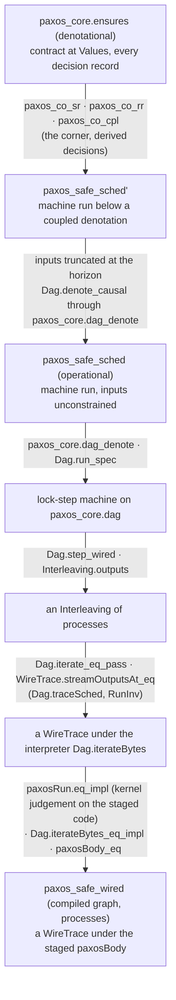

# Architecture Overview

Most tools for verifying distributed systems require you to _model_ the system in a separate language, such as a TLA+ specification or a state machine in a proof assistant, and to prove properties of that model, with the network as one component of the model's state. The model and the code that runs are separate artifacts and can diverge. In Hydro Lean you prove properties of the Hydro program itself: you prove a property once, about the program's denotational semantics, and the framework delivers it as a theorem about the bytes that processes running that same program exchange over TCP.

The core idea is that **quotients defer nondeterminism**. In the denotational semantics a stream captures all the histories it could have had (every arrival order of an unordered stream, every retry count of an at-least-once one). Nondeterminism therefore travels unresolved inside the value until an operator observes it, and only the operators that observe one particular history take a `nondet!`, as an explicit argument. The network's delay and reordering are encoded the same way, in the quotient types of the streams a receiver gets, so the transport changes no content and no proof about a program reasons about messages in flight; the coupling to `SchedSem`, where delivery is explicit, checks the encoding once for every program. [The Approach](./approach.md#quotient-denotations) gives what it replaces and what it costs, and [Grades](./semantics/grades.md) the construction.

A program has meaning at three levels, and for Paxos each level has its own safety theorem:

1. the **denotational** semantics `Values`, where contracts are proved: `paxos_core.ensures`;
2. the **operational** semantics `SchedSem`, a step machine written as an instance of the same type class: `paxos_safe_sched`;
3. the **operational execution of the compiled dataflow graph**, from a lock-step interpreter down to processes exchanging bytes: `paxos_safe_wired`.

The protocol argument is made only at the first level. Each lower theorem is derived from the one above it, through theorems proved once for all programs and per-program links that the `hydro def` command generates from the program's text, so every link between adjacent layers is a theorem, none is written by hand, and none re-argues the protocol. This page introduces the parts and shows how they connect: the vocabulary the internals pages share, the layers, one small module at every layer, the theorem chain, and a map of the source files. [How Proofs Are Generated](./proof-generation.md) follows one program through the generator.

## Vocabulary

The internals pages use the following terms without redefining them. The developer's view of the same ideas starts at [Writing Programs](../using/programs/index.md).

- A **semantics** of a program is a choice of what its collections are and what its operators do. The framework has one type class, `HydroSem`, whose fields are those choices, and every program is a Lean function taking an **instance** of it. Running a program "at" an instance means applying the function to that instance.
- A **wire** is a collection-valued binding in a program (`let b := H.batch …`), or a collection-valued input, at whatever semantics.
- A **carrier** is the type a semantics gives one kind of live collection, for instance what a `Stream` is at that semantics.
- A **grade** is a stream's pair of Rust markers, ordering (`TotalOrder`/`NoOrder`) and retries (`ExactlyOnce`/`AtLeastOnce`). At `Values` a grade picks the quotient the content lives in: a `NoOrder` stream's content is a `Multiset`, which covers all its arrival orders.
- The **denotation** is the denotational semantics `Values`: a stream captures, per cluster member, all the content histories it could have had (its **pool**), and a tick-located collection is the list of its per-tick values (a **trace**). You state and prove contracts here.
- The **step machine** is the operational semantics `SchedSem`, written as an instance of the same class: every wire is a history indexed by a global step, buffers are plain lists in arrival order, and a **pacing** says, per member and step, whether the member is idle, receives without ticking, or ticks. It bridges the denotational semantics and execution.
- A **decision** is a value that resolves one nondeterministic choice, passed to the program as an argument: a batch **cut** (which elements a tick's batch consumes), an order selection, a clock reading, a delivery cursor. Each semantics declares its own decision types; a choice that a semantics does not make has type `Unit` there. The **census** (`#nondet_census`) counts a module's content decisions, schedule sites and cycles and fails the build when they differ from the declared numbers.
- A **knot** is a cycle, Rust's `forward_ref`/`complete_cycle`, written `fix … complete`; at `Values` it is a Kleene iteration from the empty wire, and its iterates are its **stages**.
- The **corner** is the semantics `CoupleSem`, which runs the step machine and `Values` side by side up to a **horizon** `T`, the last step its theorems speak about. A corner wire has a **machine run** `sr` (the `SchedSem` value), a **denotational run** `rr` (the `Values` value), a **lag** (the coupling holds at the steps `k` with `k + lag ≤ T`), a **residual** proposition `wf`, and a proof `cpl` that under `wf` the machine's view at each such step sits below the pool. The corner's operators compute the `Values` decisions they need from their own machine runs (**derived decisions**).
- A **module** is one `hydro def`, the Lean counterpart of one Rust function. A **face** is the contract a module exports (`M.ensures`); a **ghost** is a proof step written inside a program body (`ghost have`), which the elaborator hoists to a theorem.
- **Kernel judgement** means a proof term the Lean kernel checks directly by definitional unfolding, as opposed to an elaborator-side check (`Meta.isDefEq`, `simp`).

## The Layers

A program is written once, against a signature, and every layer below reads that one text.

| Layer | What it is | Its role |
|---|---|---|
| **Surface** | `hydro def`, `tick`, `fix … complete`, `ghost have`, `ensures`/`prove` (`Hydro/HydroDef.lean`, `Hydro/HydroTick.lean`) | a line-for-line mirror of the Rust function, with the contract and its proof inline |
| **Signature** | `HydroSem L mem`, one field per operator, one carrier per live collection (`Hydro/Sem.lean`) | the program is a function of an instance of this class |
| **Denotational semantics** | `Values` (`Hydro/Values.lean`) | where contracts are stated and proved; also the executable for smoke tests |
| **Operational semantics** | `SchedSem pacing` (`Hydro/Sched.lean`) | the step machine: plain lists, delivery cursors, per-member pacing |
| **Proof instances** | `MonoRel` (`Hydro/MonoRel.lean`), `CoupleSem` (`Hydro/Couple.lean`) | monotonicity, and the coupling of operational runs to the denotation, obtained by running the program at them |
| **Generator** | the phases behind `hydro def` (`Hydro/HydroGen*.lean`) | per-module statements synthesized from the module's type, proved by fixed scripts or kernel judgements |
| **Graph** | `M.dag : Dag Γ outs` (`Hydro/Graph/`) | the program's `let`-sharing and knots made explicit, so it can be stepped |
| **Lock-step machine** | `Dag.step`, `Dag.run` (`Hydro/Project/Step.lean`) | every member of every location, one global step at a time, each node consuming and emitting **increments** (what is new on a wire at this step) |
| **Processes** | `Dag.locStep`, `Interleaving` (`Hydro/Project/Wired.lean`, `Hydro/Project/Model/WiredRun.lean`) | the lock-step machine cut to one member; an **interleaving** says which process steps when |
| **Activation** | `Dag.iterate`, `Dag.sweepF`, `hydro_run` (`Hydro/Project/Sweep.lean`, `Fused.lean`, `Hydro/HydroStage.lean`) | what a deployed process runs when it wakes (one **activation**): one sweep of its graph, each node evaluated once in dependency order, compiled to straight-line code |
| **Wire** | `Wire`, `Dag.iterateBytes`, `WireTrace` (`Hydro/Wire.lean`, `Hydro/Project/Model/WireTrace.lean`) | bytes per connection, framed, cut anywhere |

The layers group into the three levels. The **denotational** level is `Values`, where contracts are stated. The **operational level through the class** is `SchedSem`. Every stream there is a flat, concrete sequence and every nondeterministic point is an identity operator (`assume_ordering u _d := u`), so the machine, like a deployed process, has one actual order and one actual batching, and the coupling must show that whatever it produces is covered by some `Values` decision. Because `SchedSem` is an instance of the class, it reads the program text unchanged; for the same reason it defines each operator on whole runs and cannot be executed a step at a time. The **operational level over the compiled graph** is everything from the graph down. `Dag.denote` reads the graph with `SchedSem`'s definitions (`M.dag_denote` equates `Dag.denote` of the graph with the program, so `Dag.denote` applies the second level's definitions to the graph and adds no new semantics), and the lock-step machine, the processes, the activation and the bytes execute it, each proved equal to the layer above. `MonoRel` and `CoupleSem` are not levels: a program is run at them to obtain its monotonicity and the coupling of its `SchedSem` runs to its denotation. The graph exists because a type-class instance sees operator applications but not the program's `let`-sharing ([The Approach](./approach.md#the-dataflow-graph)).

### `toy_relay` at Every Layer

`toy_relay` (`Hydro/HydroGenToy.lean`) is a minimal module: bump each input, batch it per tick, gate the batches on an interval timer, and leave the tick.

```lean
hydro def toy_relay (H : HydroSem L mem) (ℓ : L)
    (inp : H.Stream ℓ Nat .noOrder .exactlyOnce)
    (dec : ToyRelayDec H (mem ℓ)) (sched : ToyRelaySched H (mem ℓ)) :
    (H.Stream ℓ Nat .noOrder .exactlyOnce
      × H.AtomicStream ℓ Nat .noOrder .exactlyOnce)
  ensures out => ToyEnsures out :=
  let bumped := H.map inp (fun _i n => n + 1)
  let b := H.batch bumped dec.batch
  let fires := H.source_interval (fun _ => 0) 1 sched.interval
  let gate := H.batch fires dec.gate
  tick (input bb := b) (input g := gate) :=
    yield (emitted := H.bfilterIf bb (H.boIsSome (H.bfirst g)));
  (H.allTicks emitted, emitted)
  prove
    pos := fun i x hx => by
      …
```

The one command produces a declaration at every layer. Each row below lists declarations that `#check` prints after the command runs.

| Layer | Generated declaration | Says |
|---|---|---|
| Denotation | `toy_relay.ensures` | `ToyEnsures (toy_relay (Values L mem) ℓ inp dec sched)` for every decision record |
| Corner, machine run | `toy_relay_co_sr₁` | the corner run's `.sr` equals the `SchedSem` run |
| Corner, denotational run | `toy_relay_vdec`, `toy_relay_co_rr₁` | the corner run's `.rr` equals the `Values` run at a decision record derived from the machine run |
| Corner, residual | `toy_relay_co_wf₁`, `toy_relay_co_lag₁` | the output's residual holds whenever the input's does; the output's lag equals the input's |
| Monotonicity | `toy_relay_mono₁`, `toy_relay_smono₁` | more input gives more output at `Values`; tick traces grow by prefixes at `SchedSem` |
| Graph | `toy_relay.dag`, `toy_relay.dag_denote`, `toy_relay.dag_valid`, `toy_relay.dag_agreeL` | the graph, its meaning (`Dag.denote`) equal to the `SchedSem` run, every cycle passing a network hop or a `defer_tick`, its lag law |
| Schedule | `toy_relay.schedOf`, `toy_relay.recordOf`, `toy_relay.schedOf_recordOf` | the module's decision records at `SchedSem` convert to the graph's schedule and back without loss |
| Wire | `toy_relay.wireCodecs` | one byte codec per network node |

The names are stable and greppable, and a consumer cites them directly: the toy's machine-safety theorem `toy_safe_sched` (`Hydro/HydroGenCheck.lean`) is built from `toy_relay_co_wf₁`, `toy_relay_co_lag₁`, `toy_relay_co_sr₁`, `toy_relay_co_rr₁`, `toy_relay.ensures` and the corner's `cpl` field, with no reasoning about the program's operators.

## The Theorem Chain

Paxos's three safety theorems are nodes A, C and G of the chain below: the contract at `Values`, the step-machine theorem with inputs unconstrained, and `paxos_safe_wired` (`Examples/Paxos/WiredSafety.lean`), which says that any two commits two processes ever emit for one slot agree, under any trace at the wire. Each arrow is a theorem, labelled by its name.



The chain moves a fact from the denotation, through the operational semantics, to the binary. Only the first link is an inclusion: the corner proves that the step machine's list at every step sits below the denotation's pool in the grade's order, so a commit the machine shows is a member of a pool the contract talks about. Every later link is an equality of outputs (the graph's reading `Dag.denote` equals the `SchedSem` run, the lock-step machine reproduces it, an interleaving of processes is a run of the lock-step machine, an activation is one lock-step step, a byte trace induces an interleaving, the staged function equals the interpreter), and equalities preserve everything. The graph is also used upstream of the machine headline: each knot's strictness, which the corner needs, is proved from the knot body's graph, and `paxos_safe_sched` removes its input premises by the graph's causality. [Soundness](./soundness.md) walks the chain link by link with the hypotheses each link adds, and lists the trust base: the kernel, the three standard axioms, nineteen kernel-checked `@[csimp]` equations, the definitions in the headline's statement, and what lies outside it.

:::note

The chain for `collect_quorum` (`cq_safe_sched'`, `cq_safe_sched` in `Hydro/Std/Quorum.lean`) and `two_pc` (`two_pc_safe_sched`, `two_pc_once_sched` in `Examples/TwoPC.lean`) stops at the machine. `paxos_safe_wired` is the one headline stated at the bytes.

:::

## Map of the Source Files

All paths are under `hydro_lean/`. The table groups files by the layer they own; a file not listed is a proof file for the row above it.

| Path | Layer | Owns |
|---|---|---|
| `Hydro/Order.lean`, `Hydro/Grades.lean`, `Hydro/Trace.lean`, `Hydro/Keyed.lean`, `Hydro/Decisions.lean` | carriers | the graded quotients (`PoolCarrier`, `StutterSeq`, `RetryPool`), `FoldOkP`, tick traces, cut legality (`batchCuts`, `realizeTicks`), keyed pools, the decision shapes |
| `Hydro/Sem.lean` | signature | `HydroSem`, `TickShape`, the program-facing `HydroSem.fix`/`fixTick` |
| `Hydro/Values.lean`, `Hydro/MemberMap.lean`, `Hydro/SimpAttr.lean` | denotation | `Values`, the member-indexed carrier and its compiled constructor, the `den` simp set |
| `Hydro/Sched.lean`, `Hydro/SchedCausal.lean`, `Hydro/SchedMono.lean`, `Hydro/SchedPaced.lean` | step machine | `SchedSem`, `StepHist`, `Pacing`, `stepGate`, the per-operator causality and tick-monotonicity laws |
| `Hydro/MonoRel.lean`, `Hydro/ValuesMono.lean` | proof instance | monotonicity by instantiation |
| `Hydro/Transfer.lean`, `Hydro/Couple.lean`, `Hydro/CoupleProj.lean` | proof instance | `ListLe`, the derive functions, `CoupleSem`, `co_fix_cpl`, the per-operator projection lemmas |
| `Hydro/KnotTactics.lean`, `Hydro/WfTactics.lean` | proof instance | `co_knot_sr`/`co_knot_rr`, `co_body_rw`, the tick-monotonicity walker |
| `Hydro/HydroDef.lean`, `Hydro/HydroTick.lean` | surface | the `hydro def` command, ghosts, `fix` hoisting, the `tick` construct and its readers |
| `Hydro/HydroGen.lean`, `Hydro/HydroGenKnot.lean` | generator | the registry, proof by script, `addThmByKernelRfl`, the per-module phases ([The Generator](./generator/overview.md)) |
| `Hydro/HydroGenLag.lean`, `Hydro/HydroGenProject.lean` | generator | the graph projection phase, per-node lag and validity proofs |
| `Hydro/Graph/IR.lean`, `Hydro/Graph/Lags.lean`, `Hydro/Graph/Causal.lean` | graph | `Kind`, `Node`, `Dag`, `Dag.denote`, the lag algebra, `cascadeValid`, `Dag.denote_causal`/`denote_agreeL` |
| `Hydro/Project/Step.lean`, `Hydro/Project/Wired.lean` | lock-step, processes | `Dag.step`, `Dag.locStep`, the memo tables and `Dag.locStepImpl` |
| `Hydro/Project/Sweep.lean`, `Hydro/Project/Process.lean`, `Hydro/Project/Fused.lean` | activation | `Dag.sweepTop`, `knotLoop`, `Dag.iterate`, `Dag.iterateBytes`, `Dag.sweepF` |
| `Hydro/Project/Wire.lean`, `Hydro/Wire.lean` | wire | `Dag.Codecs`, the delivery oracle a process reads, the `Wire` class, LEB128, frames |
| `Hydro/Project/Model/` | proofs | `Dag.run_spec`, `Dag.step_wired`, `Interleaving`, `Dag.iterate_eq_pass`, `WireTrace`, `PassTrace`, `RunInv` |
| `Hydro/HydroStage.lean` | activation | `hydro_run`, the symbolic executor of the fused sweep |
| `Hydro/Std/`, `Examples/TwoPC.lean`, `Examples/Paxos/` | programs | the mirrored Rust modules, one `hydro def` per Rust function |
| `Examples/Paxos/CoupleSafety.lean`, `Examples/Paxos/CoupleWf.lean`, `Examples/Paxos/WiredSafety.lean` | headlines | `paxos_co_sr`/`rr`/`wf`, `paxos_safe_sched'`, `paxos_safe_sched`, `paxosRun`, `paxos_safe_wired` |
| `Hydro/TransferTheory.lean`, `Hydro/Liveness.lean`, `Hydro/LivenessChain.lean` | liveness | `StabilizesAt`, fairness on the schedule space, decision chains |
| `Hydro/HydroGenToy.lean`, `Hydro/HydroGenCheck.lean`, `Hydro/HydroTickCheck.lean`, `Hydro/HydroStageCheck.lean`, `Hydro/WireTraceChecks.lean`, `Hydro/AxCheck.lean`, `Examples/AxCheck.lean` | regression | the toys every engine change is made on first, the byte-level non-vacuity scenarios, the axiom audit |
| `Examples/Demo/Falsify.lean`, `Examples/Demo/Explore.lean`, `Examples/Demo/PaxosDemo.lean`, `Examples/Demo/TwoPCDemo.lean`, `Examples/Demo/WiredDemo.lean`, `Examples/Demo/Bench.lean`, `Examples/Demo/BenchDemo.lean`, `Examples/Demo/BenchProfile.lean`, `Hydro/Project/Sockets.lean` | executables | the `Values` programs run directly, the processes over TCP, the benchmark |
| `scripts/heartbeat_table.sh`, `scripts/reach.lean`, `scripts/bench_perf_role.sh` | tooling | per-declaration cost, declaration reachability from the headlines, per-role profiling |

## Further Reading

The internals pages follow the layers top to bottom.

- [The Approach](./approach.md): the six decisions every layer follows from.
- [How Proofs Are Generated](./proof-generation.md): `toy_relay` and a knot through every generator phase.
- [Elaboration and Kernel Cost](./cost-model.md): where time and memory go, and the rules they force.
- [Semantics](./semantics/grades.md), [The Coupling Corner](./corner/coupling.md), [The Generator](./generator/overview.md), [Graph and Execution](./execution/graph-ir-causality.md): the layers in depth.
- [Soundness](./soundness.md), [Liveness](./liveness.md), [Traps](./traps.md), [Doctrine](./doctrine.md).

For the developer's view of the same machinery, start at [Writing Programs](../using/programs/index.md).
